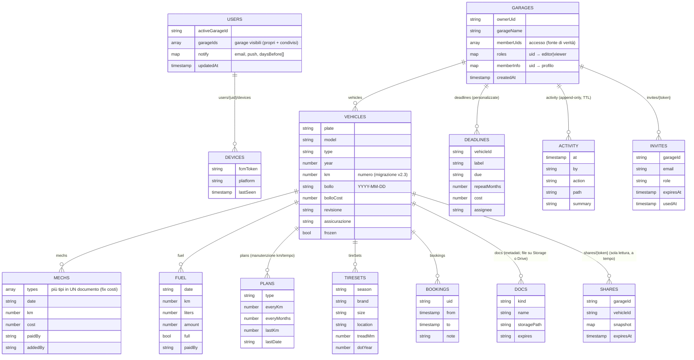

# GarageOS — Idee (Fase 2)

Il punto di vista è quello di una famiglia o di un gruppo di amici con più veicoli: chi paga, chi usa l'auto, cosa scade, quanto costa davvero ogni veicolo.

**Vincolo di partenza: piano Spark** (gratuito). I limiti sono:
- Firestore: 50.000 letture, 20.000 scritture e 20.000 cancellazioni al giorno, 1 GiB di dati;
- Auth gratuita;
- niente Cloud Functions;
- niente nuovi bucket Cloud Storage: dall'ottobre 2024 i nuovi bucket richiedono Blaze, anche se c'è una quota gratuita.

Sui dati attuali (75 documenti, 6 account) i limiti di Spark sono lontanissimi: anche raddoppiando gli utenti si resta sotto l'1% delle quote. Per ogni idea segnalo se serve Blaze e propongo un'alternativa gratuita.

**Legenda**
- **Valore**: ★ basso · ★★ medio · ★★★ alto
- **Impegno**: S ≤ 1 giorno · M 2-4 giorni · L > 1 settimana, per una persona
- **Firestore/regole**: impatto su modello dati e `firestore.rules`
- **Costi**: Spark o Blaze

---

## 1. Scadenze e promemoria

| Idea | Valore | Impegno | Firestore / regole | Costi |
|---|---|---|---|---|
| **Promemoria push** (bollo, revisione, assicurazione a 30, 7 e 1 giorno) | ★★★ | M | `users/{uid}/devices/{id}` con il token FCM; regola: ognuno scrive solo i propri | **Senza Blaze:** un workflow **GitHub Actions** schedulato (gratuito) legge le scadenze con l'Admin SDK e invia via FCM HTTP v1, che è gratuito. Con Blaze: Cloud Function schedulata, praticamente gratis a questo volume. iOS richiede la PWA installata (iOS ≥ 16.4) |
| **Promemoria via email** (alternativa o complemento alle push) | ★★ | S | `users/{uid}.notify = {email: bool, daysBefore: [30,7]}` | Gratis con GitHub Actions + SMTP (Gmail con app password o un servizio con piano free) |
| **Export .ics / "Aggiungi al calendario"** per ogni scadenza, o un file .ics di tutto il garage | ★★★ | S | Nessuno (lato client) | Spark. Un *feed* .ics in abbonamento richiederebbe un endpoint: con GitHub Actions si può generare un .ics per garage su un URL segreto, che però va trattato come dato sensibile |
| **Scadenze personalizzate** (tagliando a data, ZTL, bollino blu, Telepass, estintore, seggiolino, abbonamento parcheggio) | ★★★ | M | Nuova sottocollezione `garages/{g}/deadlines/{id}` {vehicleId?, label, due, repeatMonths, cost, assignee} | Spark |
| **"Chi se ne occupa"**: scadenza assegnata a un membro e notifiche solo a lui | ★★ | S | campo `assignee` (uid ∈ memberUids, validato nelle regole) | Spark |
| **Notifiche locali migliorate** (`periodicSync`, già presente) | ★ | S | — | Spark. Affidabili solo su Chrome Android con l'app installata: tenerle come ripiego |

## 2. Costi, consumi e chilometri

| Idea | Valore | Impegno | Firestore / regole | Costi |
|---|---|---|---|---|
| **Rifornimenti e consumi** (l/100 km, €/km, prezzo medio, rifornimento pieno o parziale) | ★★★ | M | `garages/{g}/vehicles/{v}/fuel/{id}` {date, km:number, liters:number, amount:number, full:bool, station}; le regole validano i numeri | Spark (circa 10 scritture al mese per veicolo) |
| **Spese annue per veicolo e costo totale di possesso** (bollo, assicurazione, revisione, interventi, carburante) con grafici | ★★★ | M | Aggregati calcolati sul client. Con molti anni di dati: un documento di riepilogo `stats/{year}`, aggiornato in transazione | Spark. Grafici: libreria leggera in self-hosting (Chart.js ~70 KB), da aggiungere alla CSP come `'self'` |
| **Storico km**, con aggiornamento automatico dei "km attuali" da rifornimenti e interventi e stima dei km annui | ★★ | S | `vehicles/{v}.km` diventa numero (migrazione già preparata); opzionale `odometer/{id}` | Spark |
| **Spese divise** ("chi ha pagato", saldo tra membri) | ★★ | M | campo `paidBy` (uid) su interventi e rifornimenti | Spark |
| **Dossier di vendita**: PDF con lo storico manutenzioni del veicolo da dare all'acquirente | ★★ | S | Nessuno (CSS di stampa) | Spark |

## 3. Manutenzione

| Idea | Valore | Impegno | Firestore / regole | Costi |
|---|---|---|---|---|
| **Manutenzione programmata a km o a tempo** (tagliando ogni 15.000 km o 12 mesi, cinghia ogni 120.000 km o 6 anni, freni) | ★★★ | M | `vehicles/{v}/plans/{id}` {type, everyKm, everyMonths, lastKm, lastDate}; sostituisce `tagliandoInt` | Spark |
| **Gomme come "treni"** (estive e invernali), con deposito (montate, garage, gommista), profondità del battistrada, anno DOT e storico dei cambi | ★★ | M | `vehicles/{v}/tireSets/{id}` più eventi di montaggio. Oggi `tires` sono solo eventi | Spark |
| **Checklist stagionali o di viaggio** (pressione, liquidi, catene) | ★ | S | `garages/{g}/checklists` | Spark |
| **Sinistri e multe** (data, luogo, foto, pratica) | ★★ | M | `vehicles/{v}/incidents/{id}` | Spark (senza foto) |

## 4. Documenti e foto

| Idea | Valore | Impegno | Firestore / regole | Costi |
|---|---|---|---|---|
| **Documenti e foto** (libretto, polizza, fatture) | ★★★ | M-L | Metadati in `vehicles/{v}/docs/{id}`; file su Storage con regole Storage gemelle (membro del garage) | **Firebase Storage: per i nuovi bucket serve Blaze** (con quota gratuita di 5 GB, poi a consumo). **Alternative gratuite:** (a) immagine compressa sul client (WebP ~100-300 KB) salvata come Bytes in un documento a parte, sotto il limite di 1 MiB, adatta a scontrini e polizze; (b) Google Drive dell'utente con Picker API, dove i file restano suoi |
| **OCR delle scadenze da foto** (polizza, ricevuta del bollo, revisione) | ★★ | L | Nessuno (precompila il form, conferma l'utente) | **Tesseract.js sul client: gratuito**, ~2-4 MB di WASM da caricare solo a richiesta; precisione discreta su documenti stampati. Cloud Vision richiede Blaze (gratuito fino a 1000 pagine al mese, poi a pagamento) |

## 5. Collaborazione (famiglia e amici)

| Idea | Valore | Impegno | Firestore / regole | Costi |
|---|---|---|---|---|
| **Ruoli: proprietario, editor, lettore** | ★★★ | M | `garages/{g}.roles = {uid: 'editor'\|'viewer'}`. Regole: `canWrite(gid)` = proprietario o editor. Invito con ruolo (`invites.role`) | Spark (le regole fanno già una `get` sul garage) |
| **Log delle attività** ("Tiziana ha aggiunto un intervento sulla Panda") | ★★ | M | `garages/{g}/activity/{id}` {at: serverTimestamp, by: uid, action, path, summary}, scritto **nello stesso batch** della modifica. Regole: solo create, `by == auth.uid`, `at == request.time`, niente update o delete. TTL a 12 mesi | Spark; +1 scrittura per azione. TTL disponibile senza Blaze |
| **Prenotazione "chi usa l'auto"** (calendario per veicolo, conflitti) | ★★ | M | `vehicles/{v}/bookings/{id}` {uid, from, to, note}. Le sovrapposizioni si controllano in una transazione sul client: le regole non possono interrogare altri documenti per intervallo | Spark |
| **Link in sola lettura per il meccanico** (un solo veicolo, con scadenza) | ★★ | M | `shares/{token}` (256 bit, come gli inviti) con un'**istantanea** dei dati del veicolo copiata dal client. Regola: `get` senza login se `expiresAt > request.time`; niente `list` | Spark. Lettura anonima mirata e a tempo, senza esporre il garage |
| **Più garage per utente** (il proprio più quelli condivisi, con selettore) | ★★★ | M | `users/{uid}.garageIds: []` più `activeGarageId`; regole come oggi (accesso deciso da `memberUids`) | Spark. Risolve un limite reale: chi accetta un invito oggi perde la vista sul proprio garage |

## 6. Dati, backup, portabilità

| Idea | Valore | Impegno | Firestore / regole | Costi |
|---|---|---|---|---|
| **Export JSON e CSV completo del garage** dall'app | ★★ | S | Nessuno | Spark (letture già in memoria) |
| **Import JSON/CSV** (da altre app o fogli di calcolo), con anteprima e validazione | ★★ | M | Nessuno (batch da 500 scritture; le regole validano) | Spark |
| **Backup automatico settimanale** | ★★ | S | Nessuno | `tools/admin/export-firestore.mjs` in un workflow GitHub Actions, con l'output cifrato (age o gpg) come artifact privato. L'export gestito di Firestore richiede Blaze |

## 7. UX, accessibilità, lingua

| Idea | Valore | Impegno | Note | Costi |
|---|---|---|---|---|
| **Dark mode** (automatica più interruttore) | ★★ | S | i token CSS esistono già (`:root`) | — |
| **Accessibilità**: focus visibile, `aria-label` sui pulsanti a icona, modali con focus trap ed Esc, contrasti AA, tap target ≥ 44 px | ★★★ | M | oggi i pulsanti ✏️/🗑️ non hanno etichette leggibili e le modali non intrappolano il focus | — |
| **Multilingua** (it/en) | ★ | M | testi in un dizionario, `Intl` per date e valute | — |
| **Ricerca e filtri** (targa, tipo, officina, intervallo di date) | ★★ | S | sul client | — |
| **QR code sul veicolo** che apre direttamente la sua scheda | ★ | S | libreria QR in self-hosting | — |
| **Onboarding**: veicolo d'esempio e spiegazione delle scadenze | ★ | S | — | — |

## 8. Sicurezza e robustezza (non sono "feature", ma servono)

| Idea | Valore | Impegno | Note | Costi |
|---|---|---|---|---|
| **App Check** (reCAPTCHA Enterprise), prima in monitor poi in enforce | ★★★ | S | blocca i client non ufficiali che usano la chiave pubblica | gratuito fino a 10.000 verifiche al mese |
| **TTL sugli inviti scaduti o usati** e pulizia dei `members[]` legacy | ★ | S | policy TTL su `invites.expiresAt` | Spark |
| **Timestamp del server** (`serverTimestamp()` per `createdAt`/`updatedAt`) | ★★ | S | nel piano (Fase 3) | — |

---

## Modello dati v3 (proposta)

**Principi del modello v3**
- I numeri sono `number`, le date di calendario stringhe `YYYY-MM-DD`, gli istanti `Timestamp` del server.
- I sotto-documenti sono **per veicolo**: le query restano piccole, e si possono cancellare veicoli e storico in un batch.
- Un intervento multi-tipo è **un solo documento** con `types[]`, così i costi duplicati spariscono alla radice. Serve una migrazione: raggruppare i documenti con lo stesso `createdAt`.
- Ogni nuova collezione nasce **con regole e test** (stesso schema di `tests/rules`), con validazione dei soli campi toccati in update.
- Indici composti previsti: `fuel` per (`date` desc) e `deadlines` per (`due` asc, `vehicleId`). Si aggiungono a `firestore.indexes.json` quando servono davvero.

---

## Roadmap

| Tappa | Contenuto | Costi |
|---|---|---|
| **MVP: v2.3, "solidità"** (in preparazione, branch `fix/v2.3`) | offline vero, bug del service worker, costi multi-tipo, hook pre-commit, numeri e migrazione (solo dry-run), timestamp del server, App Check in monitor | Spark |
| **v2.4, "valore immediato"** | export .ics e "Aggiungi al calendario", scadenze personalizzate, rifornimenti e consumi, spese annue con grafici, dark mode, export JSON | Spark |
| **v2.5, "famiglia e amici"** | più garage per utente, ruoli, log attività, prenotazioni, link in sola lettura per il meccanico, accessibilità | Spark |
| **v3, "automazione"** | promemoria push ed email via GitHub Actions, manutenzione programmata a km o tempo, treni di gomme, documenti (Bytes compressi o Drive), OCR con Tesseract.js, dossier di vendita | Spark + GitHub Actions; Blaze **solo** se si vuole Firebase Storage o Cloud Functions |

**Le mie tre priorità per una famiglia:**
1. scadenze nel calendario e promemoria;
2. più garage per utente;
3. rifornimenti e spese annue.

Le prime due eliminano le frustrazioni di oggi; la terza dà il "perché" per aprire l'app ogni settimana.
