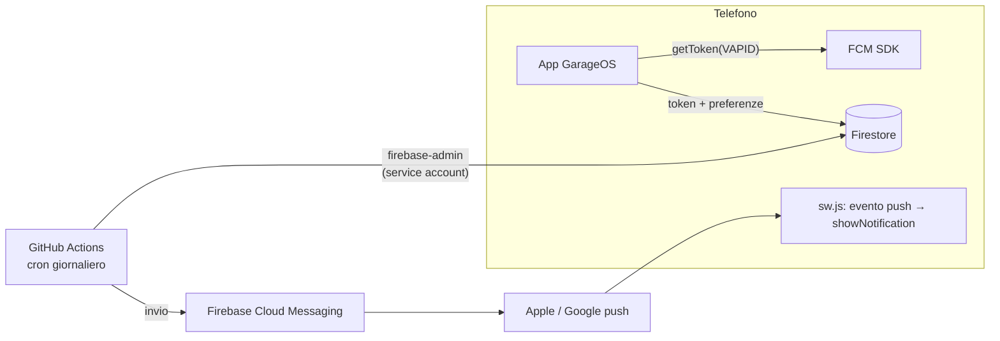

# Notifiche push delle scadenze: proposta di architettura (DA APPROVARE)

Stato: **solo proposta**. Nessun codice scritto, nessuna modifica a regole, Console o GitHub.
Vincolo: piano **Spark** (niente Cloud Functions).

---

## 1. Cosa esiste oggi (verificato nel codice)

Oggi ci sono notifiche **locali**: nessun server e nessuna push vera.

1. **Snapshot.** A ogni aggiornamento dei veicoli l'app salva in `caches['garageos-notif']` (chiave `notif-data`) uno snapshot `{deadlines: [{plate, label, date}], lastNotified}` con bollo, revisione e assicurazione dei veicoli non congelati (`saveDeadlineSnapshot`, `js/app.js`).
2. **Controllo nel service worker.** Il SW (`checkDeadlines` in `sw.js`) legge lo snapshot e mostra **una** notifica riassuntiva con le scadenze a ≤ 10 giorni, al massimo una volta ogni 20 ore. Il controllo parte in due casi:
   - **all'apertura dell'app** (messaggio `CHECK_DEADLINES`), cioè proprio quando la notifica serve meno;
   - con **Periodic Background Sync** (`garageos-check`, ogni ≥ 12 h): solo Chrome/Android con la PWA installata, e a discrezione del browser in base all'uso. Su iPhone non esiste.
3. **Attivazione.** Il menu utente ha "🔔 Attiva notifiche", che chiede il permesso (mai al primo avvio).

**Limiti:**
- se l'app non viene aperta, non arriva nulla (eccetto un Periodic Sync inaffidabile);
- lo snapshot è fermo all'ultima apertura;
- soglia fissa di 10 giorni;
- non funziona su iPhone;
- dalla v2.3 il logout cancella lo snapshot.

**Proposta:** tenere questo meccanismo come ripiego offline e affiancargli le push vere.

---

## 2. Architettura proposta



### 2.1 Client

**Pulsante.** "🔔 Attiva promemoria" nel menu utente e nella scheda Scadenze. Il permesso si chiede **solo al tocco**, mai al primo avvio.

**Token.** Si ottiene con `firebase-messaging.js` (gstatic 10.11.0, come gli altri SDK) e `getToken({ vapidKey, serviceWorkerRegistration })`, usando **il nostro `sw.js`** e non un secondo service worker.

**Ricezione nel service worker.** `sw.js` gestisce direttamente l'evento `push`: legge il JSON di FCM e chiama `showNotification`, senza SDK nel service worker.
- Su iOS ogni push deve mostrare una notifica: è il nostro caso.
- Al click la notifica apre la scheda Scadenze.

**Dove si salvano i token:** `users/{uid}/pushTokens/{tokenId}`.
- `tokenId` = SHA-256 esadecimale del token. Il token contiene caratteri poco adatti a un ID ed è lungo; così l'ID è stabile e non duplica.
- Campi: `token` (≤ 4096), `platform` (`ios|android|desktop`), `createdAt` (timestamp del server), `lastSeenAt` (timestamp del server), `appVersion`.

**Ciclo di vita del token:**
- all'apertura dell'app, se il permesso è concesso, `getToken()`: se è cambiato si salva il nuovo e si cancella il vecchio; `lastSeenAt` si aggiorna al massimo una volta al giorno (1 scrittura/giorno/dispositivo);
- "Disattiva promemoria" e **logout**: `deleteToken()` + cancellazione del documento, prima del `signOut`;
- permesso revocato dalle impostazioni del telefono: all'apertura `Notification.permission !== 'granted'` → cancellazione del documento;
- i token che FCM dichiara non validi li cancella lo script di invio (§2.2), così come quelli con `lastSeenAt` più vecchio di 60 giorni (raccomandazione di Firebase).

**Preferenze.** Nel documento `users/{uid}`, campo `push`:
```json
{ "enabled": true, "days": [30, 7, 1], "details": true }
```
- `days`: giorni di preavviso, da 1 a 5 valori tra 0 e 90 (default 30, 7, 1);
- `details`: se `false`, la notifica dice solo "Hai 2 scadenze in arrivo", senza targa (§4, privacy).

Le preferenze valgono per tutti i dispositivi dell'utente e si modificano da una piccola finestra "Promemoria".

**iPhone.** Se il dispositivo è iOS e l'app **non** è in modalità standalone (`navigator.standalone !== true` e non `display-mode: standalone`), al posto del pulsante compare un riquadro:

> Per ricevere i promemoria su iPhone: tocca **Condividi** → **Aggiungi alla schermata Home**, poi apri GarageOS dall'icona e attiva i promemoria. Serve iOS 16.4 o successivo.

Sotto iOS 16.4 il messaggio dice che le push non sono disponibili e suggerisce il calendario (.ics), che è già pronto.

**CSP.** In `connect-src` si aggiungono `https://fcmregistrations.googleapis.com` e `https://firebaseinstallations.googleapis.com`; da verificare con un e2e.

### 2.2 Regole Firestore (con test sull'emulatore)

```
match /users/{uid}/pushTokens/{tid} {
  allow read, delete: if signedIn() && request.auth.uid == uid;          // get e list solo i propri
  allow create, update: if signedIn() && request.auth.uid == uid
    && tid.matches('^[a-f0-9]{64}$')
    && <campi ammessi e tipi> && lastSeenAt == request.time;
}
```

- **`validUser`:** si aggiunge la chiave `push`, validata così: `enabled` bool; `days` lista di int con `size() <= 5`, ogni valore 0-90; `details` bool. La validazione per elemento è fatta con `hasOnly` su un insieme fisso: le regole non hanno cicli.
- **`pushLog`** (registro degli invii, §2.3): **nessun accesso dai client**; lo scrive solo lo script.

**Test da scrivere:**
- l'utente legge, scrive ed elenca i **propri** token;
- un altro utente (anche dello stesso garage) **non** legge né elenca i token altrui, nemmeno con una query `collectionGroup`;
- i campi non validi sono respinti;
- `pushLog` è inaccessibile a tutti i client;
- le preferenze non valide sono respinte;
- le 102 regole attuali restano verdi.

### 2.3 Invio: GitHub Actions + script Node

**Workflow** `.github/workflows/reminders.yml`:
- `schedule: cron '17 6 * * *'`, cioè 06:17 UTC = 07:17 in inverno e 08:17 in estate. I minuti `:17` evitano la coda dell'ora piena;
- anche `workflow_dispatch` (lancio manuale, con opzione `dry-run`);
- gira **solo su `main`**, non sulle PR: i segreti non sono mai esposti al codice delle PR;
- `concurrency: reminders` (mai due esecuzioni in parallelo), `permissions: contents: read`.

**Script** `tools/push/send-reminders.mjs` (firebase-admin: Firestore + Messaging):
1. Calcola "oggi" nel fuso **Europe/Rome**.
2. Legge **tutti** i `pushTokens` con una sola query `collectionGroup` (sono pochi) e li raggruppa per `uid`.
3. Per ogni `uid`:
   - legge `users/{uid}`: preferenze e `garageId`; se `push.enabled` non è attivo, salta l'utente;
   - legge `garages/{garageId}` e **verifica** che l'utente sia proprietario o in `memberUids`. Un ex membro non riceve nulla, anche se il suo `users` punta ancora lì.
4. Per ogni garage coinvolto (letto **una volta**) legge `vehicles` e, quando F2 sarà pubblicato, `deadlines`.
5. **Scadenze da notificare:** si escludono i veicoli congelati e si calcolano i giorni mancanti `d`.
   - Per ogni soglia `t` dell'utente con `d <= t` si sceglie **la soglia più piccola non ancora inviata**. Così, se il job ha saltato un giorno, recupera senza mandare tre notifiche.
   - Le scadenze già passate da oltre 1 giorno si ignorano.
6. **Idempotenza:** per ogni coppia (utente, scadenza, data, soglia) c'è un documento in `pushLog/{sha256(uid|garage|chiaveScadenza|data|soglia)}`, creato con `create()`, che fallisce se esiste già.
   - Prima si crea il registro, poi si invia: un secondo run nello stesso giorno, o un run doppio, non manda doppioni.
   - Se l'invio fallisce per un errore temporaneo, il registro viene cancellato e il run successivo riprova.
   - Quando una scadenza viene rinnovata cambia la data, quindi la chiave: le soglie ripartono da zero.
7. **Una sola notifica per utente al giorno**, riassuntiva, per esempio "GarageOS — 2 scadenze: AB123CD Bollo tra 7 giorni; Telepass domani". Si invia con `sendEachForMulticast` a tutti i suoi token.
8. **Token non validi:** con `messaging/registration-token-not-registered` o `invalid-registration-token` il documento del token viene cancellato. I token con `lastSeenAt` oltre 60 giorni vengono cancellati.
9. **Pulizia:** si cancellano i `pushLog` più vecchi di 400 giorni.
10. **Log:** il repo è **pubblico**, quindi anche i log delle Actions lo sono. Lo script stampa **solo conteggi** (utenti, notifiche inviate, token rimossi), mai email, targhe o uid.
11. **Modalità `--dry-run`:** calcola e stampa i conteggi senza inviare né scrivere. Si collauda così in produzione prima del primo invio vero.

**Test:**
- unit test della logica pura (soglie, recupero dei giorni saltati, fuso orario, congelati, ex membri);
- e2e sull'emulatore Firestore con FCM **simulato**: Messaging non ha un emulatore, quindi si inietta un finto `send` che registra i messaggi e restituisce anche errori "token non registrato";
- verifica dell'idempotenza: due run consecutivi devono dare un solo invio.

### 2.4 Service account (lo crei tu dalla Console)

**Ruoli minimi:**

| Ruolo | Perché |
|---|---|
| `Cloud Datastore User` (`roles/datastore.user`) | leggere token, utenti, garage e veicoli; scrivere `pushLog`; cancellare i token non validi |
| `Firebase Cloud Messaging API Admin` (`roles/firebasecloudmessaging.admin`) | inviare le notifiche (FCM HTTP v1) |

Nota onesta: in IAM non si può restringere l'accesso a singole collezioni Firestore. `datastore.user` legge e scrive **tutto** il database, quindi la sicurezza dipende dal custodire bene la credenziale (vedi le due opzioni sotto).

**Opzione A, consigliata: senza chiavi (Workload Identity Federation con l'OIDC di GitHub).** Nessun segreto da custodire o ruotare; solo il workflow di `main` di questo repo può impersonare l'account.
1. Google Cloud Console → IAM e amministrazione → **Service account** → Crea: nome `garageos-reminders`, con i due ruoli sopra.
2. IAM → **Workload Identity Federation** → Crea pool `github`, provider OIDC `https://token.actions.githubusercontent.com`. Condizione sull'attributo: `assertion.repository == 'lucsor/garageos-v2' && assertion.ref == 'refs/heads/main'`.
3. Sul service account → Autorizzazioni → concedi `Workload Identity User` al principal del pool, filtrato sul repo.
4. Mi mandi l'ID del provider e l'email del service account: **non sono segreti**. Il workflow usa `google-github-actions/auth`.

**Opzione B, più semplice: chiave JSON in GitHub Secrets.**
- Passi: crea il service account come sopra → Chiavi → Aggiungi chiave → JSON. Su GitHub: repo → Settings → Environments → `reminders` → secret `FIREBASE_SA_KEY`. L'environment si può proteggere: solo branch `main`.
- Rischio: se la chiave esce, dà accesso a tutto il database finché non la revochi. Da ruotare ogni anno.

**Altre impostazioni una tantum** (Console Firebase → Impostazioni progetto → Cloud Messaging):
- verificare che **Firebase Cloud Messaging API (V1)** sia abilitata (è gratuita);
- in "Web Push certificates" generare la **coppia di chiavi VAPID**. La chiave pubblica va nel codice (non è segreta).

### 2.5 Keepalive dei cron di GitHub

GitHub **disattiva i workflow pianificati** di un repo pubblico dopo **60 giorni senza attività**: a GarageOS può capitare.

**Soluzione:** nello stesso workflow, il primo giorno del mese, uno step chiama
`gh api -X PUT repos/lucsor/garageos-v2/actions/workflows/reminders.yml/enable` con `permissions: actions: write`. È il metodo usato dalle action di keepalive più diffuse e azzera il contatore senza commit finti: niente commit vuoti su `main`, che farebbero ripartire Pages.

**Rete di sicurezza:**
- lo script scrive `pushLog/_heartbeat` con la data dell'ultima esecuzione;
- l'app, per il proprietario, mostra un avviso discreto se il heartbeat ha più di 3 giorni ("promemoria non inviati da X giorni");
- GitHub manda comunque un'email al proprietario del repo quando un run fallisce.

### 2.6 Costi (quota gratuita Spark: 50.000 letture, 20.000 scritture, 20.000 cancellazioni al giorno)

Stima con 3-5 garage, circa 10 utenti, circa 20 dispositivi e circa 30 veicoli.

| Chi | Letture/giorno | Scritture/giorno |
|---|---|---|
| Job: `pushTokens` (collectionGroup) | ~20 | — |
| Job: `users` + `garages` | ~15 | — |
| Job: `vehicles` (+ `deadlines` con F2) | ~30-60 | — |
| Job: `pushLog` (create, heartbeat, pulizia) | ~5 | ~5-10 |
| Client: `lastSeenAt` del token (max 1/giorno/dispositivo) | — | ~20 |
| **Totale** | **~100** (0,2 % della quota) | **~30** (0,15 %) |

- FCM è gratuito.
- Le Actions in un repo pubblico non consumano minuti: un run dura circa 30 secondi.
- Anche con 10 volte gli utenti si resta sotto il 2 % della quota.

---

## 3. Rischi

1. **iPhone.**
   - Servono iOS ≥ 16.4, l'app **aggiunta alla Home** e il permesso concesso **dall'app installata**, separatamente su ogni dispositivo.
   - Chi usa GarageOS da Safari non riceverà nulla. Lo dice il riquadro in-app; il calendario `.ics` resta l'alternativa.
2. **Ritardi dei cron di GitHub:** possono partire con minuti o, raramente, ore di ritardo, e in casi estremi saltare un'esecuzione. Il recupero delle soglie (§2.3, passo 5) evita di perdere promemoria.
3. **Credenziale con accesso a tutto il database** (IAM non scende a livello di collezione). Mitigazione: opzione A senza chiavi, environment protetto, solo `main`.
4. **Log pubblici:** solo conteggi; da verificare con un test che lo script non stampi email o targhe.
5. **Privacy del contenuto:** il testo della notifica (targa, tipo di scadenza) transita per FCM e per i servizi push di Apple e Google. Mitigazione: preferenza `details: false` per notifiche senza dettagli.
6. **Token "orfani":** dispositivi persi o browser reinstallati restano fino a 60 giorni; nessun danno, solo invii a vuoto.
7. **Multi-garage (F5, futuro):** oggi l'utente ha un solo `garageId`. Lo script è scritto per garage, quindi con F5 si estende alla lista dei garage dell'utente.
8. **F2 non ancora pubblicato:** lo script leggerà `deadlines` solo dopo il deploy di F2; fino ad allora solo bollo, revisione e assicurazione.

## 4. Alternative considerate

| Alternativa | Pro | Contro |
|---|---|---|
| **Solo notifiche locali** (oggi) | zero infrastruttura | arrivano solo se si apre l'app; niente su iPhone |
| **Solo calendario .ics** (già in produzione) | promemoria nativi del telefono, ottimi su iPhone, nessun server | da rifare a ogni rinnovo; Google Calendar ignora i promemoria del file |
| **Email** da GitHub Actions (SMTP Gmail con password per app) | funziona ovunque senza installare nulla | serve una casella e un segreto SMTP; le email finiscono facilmente ignorate o in spam |
| **Web Push senza FCM** (VAPID proprio + libreria `web-push`) | niente SDK FCM nel client | si gestiscono a mano le sottoscrizioni e gli errori; nessun vantaggio reale su FCM |
| **Blaze + Cloud Functions pianificate** | più affidabile del cron di GitHub, niente keepalive | richiede un account di fatturazione, contro il vincolo Spark |

**Raccomandazione:** FCM + GitHub Actions come sopra, con l'opzione A (senza chiavi) per il service account. Le notifiche locali restano come ripiego e il calendario `.ics` come alternativa per chi non installa l'app.

## 5. Piano di lavoro (dopo la tua approvazione)

Branch `feat/push-notifications`, PR senza merge finché non è tutto verde:
1. regole + test (`pushTokens`, `users.push`, `pushLog`);
2. client: pulsante, preferenze, token, riquadro iPhone, `push` nel SW, CSP + e2e;
3. script di invio + test (unit, emulatore, FCM simulato, idempotenza, log senza dati personali);
4. workflow con `--dry-run` di default e keepalive;
5. **le tue azioni:** VAPID, service account (A o B), environment GitHub;
6. con il tuo ok: deploy delle regole → deploy dell'app → un `workflow_dispatch` in dry-run sulla produzione → primo invio vero.
