# Stato del lavoro — aggiornato 2026-11-09

> **In produzione: v2.7.0** (`main` = `7d179f6`, merge della #17), regole **`80c23d65`** (sha256 `45013978…` = `firestore.rules`).
> **Cosa ti serve fare:**
> 1. Le prove dal telefono del registro pagamenti (§0.2).
> 2. Rivedere la PR B (tema scuro, v2.7.1) quando è pronta.
> 3. Restano aperte le richieste dell'8/11: avviso all'amico (§3.2) e conteggi dei promemoria dopo l'11/11 (§3.3, vedi anche la correzione in §0.3).

## 0. Piano v2.7 / v2.8 (`docs/PIANO-v2.7.md`)

| PR | Versione | Contenuto | Stato |
|---|---|---|---|
| **A** | 2.7.0 | Registro pagamenti in Spese (filtri, modifica, eliminazione) + **Pagato / Previsto** nelle spese annue (grafico, tabella, CSV). I pagamenti dei veicoli eliminati restano come "Veicolo rimosso" (opzione b) | **IN PRODUZIONE** il 9/11 (§0.1) |
| **B** | 2.7.1 | Tema scuro: token per i ~75 colori scritti a mano, blocco `prefers-color-scheme: dark`, selettore Auto / Chiaro / Scuro in Impostazioni, `theme-color` dinamico, contrasto AA | **in revisione** (§0.4), nessuna regola da pubblicare |
| **C** | 2.8.0 | Parti d'usura (`garages/{g}/wear`): stato da km e tempo, "🔧 Sostituito", badge e avvisi | da fare, nuove regole `wearOk()` |
| **C2** | 2.8.1 | Promemoria push per le parti d'usura (soglie km/giorni nello script del cron) | da fare dopo C e dopo la decisione sul passo 7 dei promemoria |
| **D** | 2.8.2 | Export JSON del garage + import additivo, solo per il proprietario, con anteprima | da fare |

**Correzioni al piano emerse verificandolo sul codice (9/11):**
- la delegation è `data-action`, non `data-click`, e la chiusura dei modali usa `close-modal`;
- per il proprietario si usa la variabile `isOwner`, perché `isOwnerOfGarage()` non esiste;
- la conferma passa da `showConfirm()`;
- il markup dei modali è `.modal-overlay > .modal`;
- **oggi qualunque membro può eliminare un veicolo** (`vehicles`: `delete if isMember`), quindi l'opzione (a) del piano non corrisponde alla situazione attuale. Si è scelta la (b);
- i test PY-P01…P10 hanno il prefisso perché P01…P10 sono già i casi dell'audit.

**Nota di deploy della PR A:** dopo le nuove regole, un client **v2.6.1** ancora aperto che elimina un veicolo prova a cancellare anche i pagamenti. Se a farlo è un membro e i pagamenti sono di altri, quelle cancellazioni vengono respinte (toast d'errore), ma il veicolo viene eliminato e i pagamenti restano: è l'esito voluto dalla (b). La finestra dura finché il telefono non si aggiorna alla 2.7.0.

Schermata del registro (390 px, emulatore): 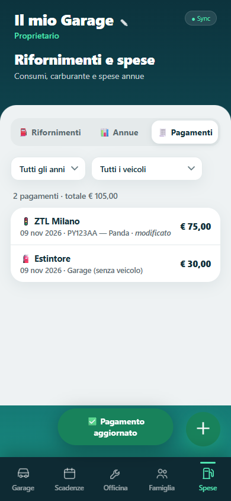

### 0.1 Rilascio della v2.7.0 (9/11, sera)
| Passo | Esito |
|---|---|
| Backup dei dati | `firestore-20261109-2143.json` (81 documenti, conteggi uguali all'8/11, 0 pagamenti) e Auth (6 account), fuori dal repo |
| Backup delle regole pubblicate | ruleset `42869098`, identico a `firestore.rules` di `main` → `docs/rules-backup/pre-v2.7.rules` |
| Deploy delle regole `payments` | ruleset **`80c23d65`**, sha256 `45013978…` **identico** a `firestore.rules` del branch |
| Merge della **#17** | `7d179f6`, CI verde (3 controlli), Pages pubblicato |
| Controllo in produzione (headless, anonimo, 390 px) | cache `garageos-v2.7.0`, login mostrato, sezione Pagamenti servita, **0 errori** in console, pagina e rete, **0 violazioni CSP** anche dopo la ricarica |
| Rollback | `firebase.rollback.json` → `docs/rules-backup/pre-v2.7.rules` (ruleset `42869098`) |

Rollback, se serve:
1. Prima l'app: `git revert -m 1 7d179f6`.
2. Poi le regole: `npx firebase-tools deploy --only firestore:rules --config firebase.rollback.json --project garageos-879bc`.

L'ordine conta: la 2.7.0 con le regole vecchie non riesce a salvare le modifiche ai pagamenti.

### 0.2 Prove dal telefono (registro pagamenti)
1. **Aggiornamento:** banner "Nuova versione" → una ricarica → Spese ha tre segmenti: ⛽ Rifornimenti · 📊 Annue · 🧾 Pagamenti.
2. **Registrare:** Scadenze → una scadenza personalizzata con importo → «✅ Fatto» → conferma l'importo. Poi Spese → 🧾 Pagamenti: la riga c'è, con data, veicolo e importo, e il totale in alto.
3. **Filtri:** l'anno e il veicolo cambiano righe e totale. "Garage (senza veicolo)" compare solo se c'è un pagamento senza veicolo.
4. **Modifica:** tocca la riga → cambia l'importo (es. da 80,50 a 75) → Salva. Controlla tre cose:
   - toast "Pagamento aggiornato";
   - la riga dice "modificato";
   - il totale e le Spese annue dell'anno cambiano.

   Prova anche "1.500,5" e il campo vuoto: devono essere respinti con un messaggio, senza chiudere la finestra.
5. **Eliminazione:** tocca la riga → Elimina. Deve comparire la finestra di conferma dell'app (non quella grigia del browser), con «la scadenza non torna indietro». Dopo la conferma il pagamento sparisce dal registro e dalle Spese annue.
6. **Pagato / Previsto:** Spese → 📊 Annue.
   - Gli anni futuri con bollo, revisione o assicurazione hanno **una barra tratteggiata blu** (Previsto) e **"€ 0"** nella colonna Pagato.
   - La tabella ha la colonna **Previsto**.
   - L'anno in corso mostra nel Pagato solo ciò che è già pagato o già scaduto.
7. **CSV spese annue:** l'ultima colonna è "Previsto (€)", e "Totale pagato (€)" non contiene le scadenze future.
8. **Da un membro** (se un familiare collabora): vede il registro e può correggere un pagamento, ma **non vede "Elimina"** su un pagamento registrato da te.
9. **Veicolo eliminato** (solo se ne hai uno di prova): i suoi pagamenti restano nel registro come "Veicolo rimosso", con il filtro "Veicoli rimossi".

### 0.4 PR B — tema scuro (v2.7.1), in revisione
- **Dove:** il selettore **Tema: Auto / Chiaro / Scuro** è nel menu utente (avatar). Nell'app non esiste una sezione "Impostazioni": il menu utente è già il posto delle preferenze, come Promemoria.
- **Come funziona:**
  - `js/theme-init.js` gira in `<head>` prima del CSS (script esterno, per la CSP) e imposta `data-theme` e `theme-color`;
  - "Auto" non salva nulla e segue il sistema;
  - la testata con il gradiente resta scura in entrambi i temi, così come la barra in basso.
- **Contrasto AA:**
  - unit test sulle coppie di token in entrambi i temi;
  - e2e che misura **ogni testo visibile** contro il suo fondo reale in tutte le schede, nel menu e nelle finestre.

  La misura ha trovato tre problemi **già presenti nel tema chiaro**, ora corretti: l'opacità sulla data dei km e sul veicolo sospeso, l'ambra sull'avviso giallo e le voci della barra in basso.
- **Trovato e corretto:** con un account Google senza foto l'avatar era nascosto, quindi il menu non si apriva (Promemoria, Esci). Ora compare l'iniziale.
- **Da sapere:** a 390 px la tabella delle Spese annue, con la colonna Previsto, scorre in orizzontale dentro il suo riquadro (la pagina no).

| | Chiaro | Scuro |
|---|---|---|
| Garage | 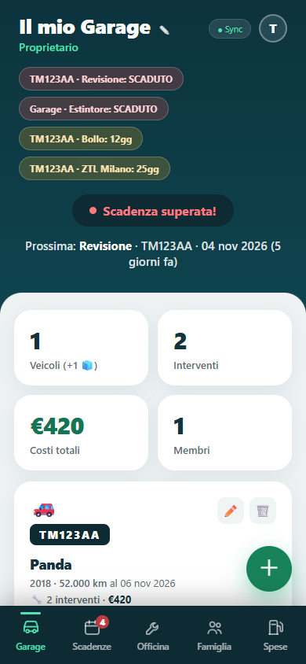 | 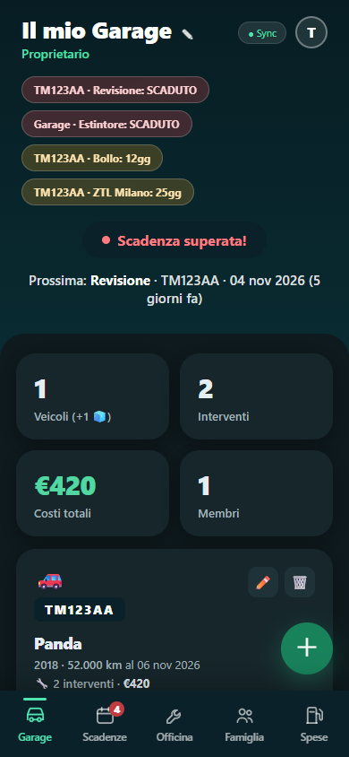 |
| Scadenze | 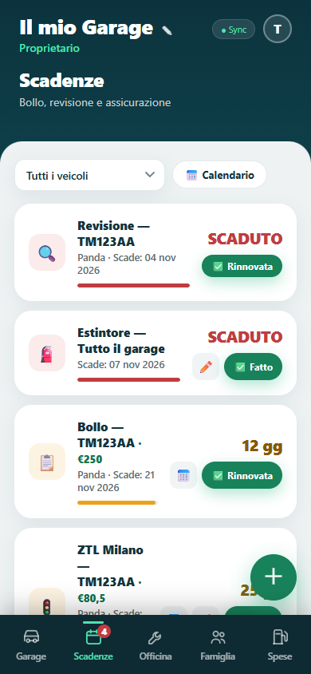 | 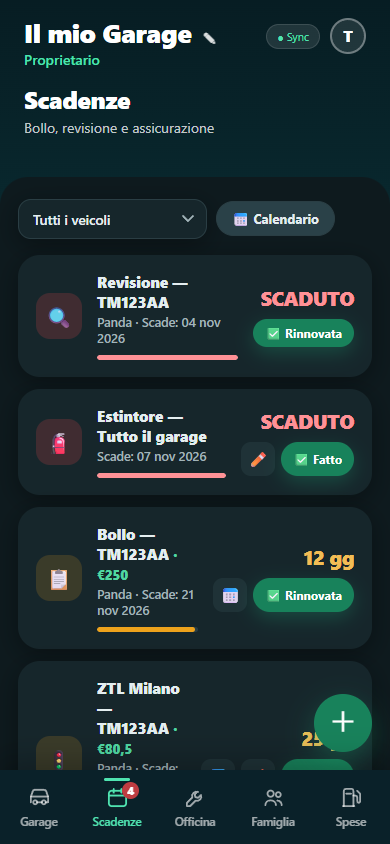 |
| Spese annue | 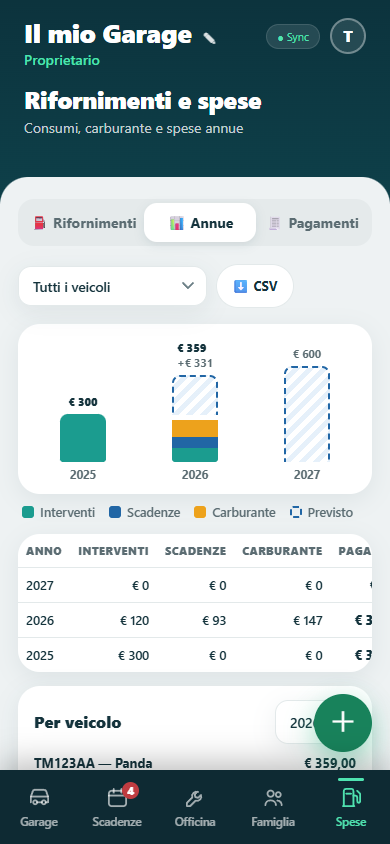 | 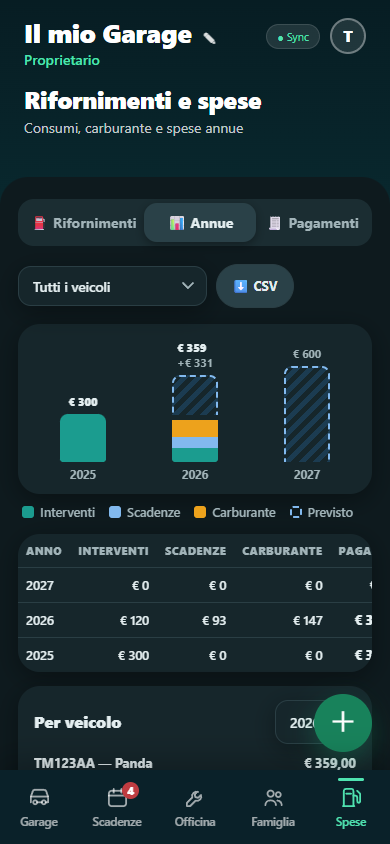 |

**Prove dal telefono (dopo il merge):**
1. Con il telefono in tema scuro e l'app su "Auto": l'app è scura e la barra di stato è scura.
2. Cambia il tema del sistema con l'app aperta: l'app segue.
3. Menu (avatar) → **Chiaro**: l'app resta chiara anche con il sistema scuro. Chiudi e riapri: la scelta resta.
4. Torna su **Auto**: l'app segue di nuovo il sistema.
5. In tema scuro, i campi data e i menu a tendina delle finestre devono essere scuri e leggibili.

### 0.3 Correzione sul cron dei promemoria
L'8/11 avevo scritto che la prima esecuzione pianificata era stata **saltata**: non è così. Era solo **molto in ritardo**. `gh run list` ora mostra due esecuzioni `schedule` riuscite:
- 8/11 alle 13:23 UTC (previsto 06:17);
- 9/11 alle 16:17 UTC.

GitHub, nel piano gratuito, ritarda i cron anche di ore. Lo script è idempotente, quindi un orario di riserva non serve. Se un ritardo di 7–10 ore è un problema per l'ora in cui ricevi la notifica, si può valutare un orario anticipato.

---

# Stato dell'8/11 (sera)

## 1. Cosa è stato fatto oggi (in ordine)

| # | Cosa | Versione | Merge | Verifica in produzione |
|---|---|---|---|---|
| 1 | **#7** correzione della CI di main | — | `0dc1d80` | CI di main tornata verde |
| 2 | **#11** STATO del 7/11 | — | `a18f463` | — |
| 3 | **#9** accessibilità + **quick win P1** (`fadeIn` da opacità 0.01: ora l'FCP si misura) | 2.5.2 | `e13fa72` | SW e cache 2.5.2, FCP ~190 ms, 0 errori, 0 violazioni CSP |
| 4 | **#12** avviso "vecchia icona" con l'app già installata (nuova, su tua richiesta) | 2.5.3 | `578691f` | `?from=v1`: avviso nel flusso della pagina, istruzioni ⋮ in evidenza, 0 errori |
| 5 | **Backup + regole** F2 + rifornimenti in **un solo deploy** | — | — | backup dati e Auth 07:34, regole precedenti salvate; poi ruleset `e08c501a` con sha256 `8f6e631a…` identico al file testato (120/120) |
| 6 | **#10** scadenze personalizzate (F2), `docs/f2-wip/` eliminata | 2.5.4 | `0414752` | SW 2.5.4, 0 errori |
| 7 | **#8** rifornimenti, consumi, spese annue, con le tue modifiche (sotto) | 2.6.0 | `bc31619` | SW 2.6.0, 0 errori |
| 8 | **garageOS#2** redirect della v1 con `?from=v1` | v1 | `12a85eb` | `lucsor.github.io/garageOS/` porta alla v2 con l'avviso e il parametro tolto |
| 9 | **Promemoria, passo 5** (dry-run in produzione) | — | — | 1 utente, 1 dispositivo, 1 notifica con 2 scadenze, 0 errori |
| 10 | **Promemoria, passo 6** (primo invio reale, solo a te) | — | — | `REMINDERS_ALLOW_LIVE=yes`; invio `live`: 1 notifica inviata, 0 errori |

Ogni PR: tolta dalla bozza → aggiornata su main → CI verde (3 controlli obbligatori) → merge → Pages → controllo della produzione.
Nessun rollback è stato necessario.

**#12, avviso "vecchia icona"**
- Con la v2 già installata ma aperta nel browser, Chrome non manda `beforeinstallprompt`.
- Ora `navigator.getInstalledRelatedApps()` lo rileva: il manifest ha `related_applications`, che punta a sé stesso. L'avviso dice «L'app è già installata: aprila dalla schermata Home e cancella la vecchia icona» e il pulsante Installa sparisce.
- Se l'app non risulta installata, o se non si può sapere: Installa mostra **in evidenza** le istruzioni del menu ⋮ (su iPhone, quelle di Condividi).
- L'avviso è nel flusso della pagina e spinge giù il contenuto. Dopo "Ho capito" il contenuto risale.
- Nuovi casi E2E: "già installata", "API presente ma non installata", "contenuto non coperto".
- Numerazione: F2 è passata a 2.5.4.

**#8, le tue modifiche**
- **"Pagato" = tutto ciò che ha un importo**, contato nell'anno della sua data:
  - interventi (i costi multi-tipo contati una volta);
  - rifornimenti;
  - bollo, revisione e assicurazione del veicolo alla loro data;
  - scadenze personalizzate alla data `due`, anche negli anni futuri.
  - Le scadenze di tutto il garage compaiono come "Garage (senza veicolo)".
  - **Unica regola contro il doppio conteggio:** una scadenza del veicolo non conta se nello stesso anno c'è già un intervento dello stesso tipo (es. "✅ Rinnovata").
  - **Limite:** il "✅ Fatto" di una scadenza personalizzata ricorrente sposta la data e non registra un pagamento, quindi l'importo passa all'anno successivo.
- **Spese** è la **quinta voce** in basso (dopo Famiglia), con Rifornimenti e Spese annue (grafico, tabella, CSV).
- **Km dal rifornimento:** il veicolo prende `km` e `kmDate` dal rifornimento solo se è il più recente per data **e** ha più km di quelli attuali.
- **Date vuote, per il futuro:** aprendo una finestra, solo la data di intervento, gomme e rifornimento parte da oggi. Bollo, revisione, assicurazione, "km al" e scadenze personalizzate restano vuote. C'è un test E2E.

## 2. Colori della #9: prima e dopo (390 px, emulatore)

| | Prima (v2.5.1) | Dopo (v2.5.2) |
|---|---|---|
| Dashboard | 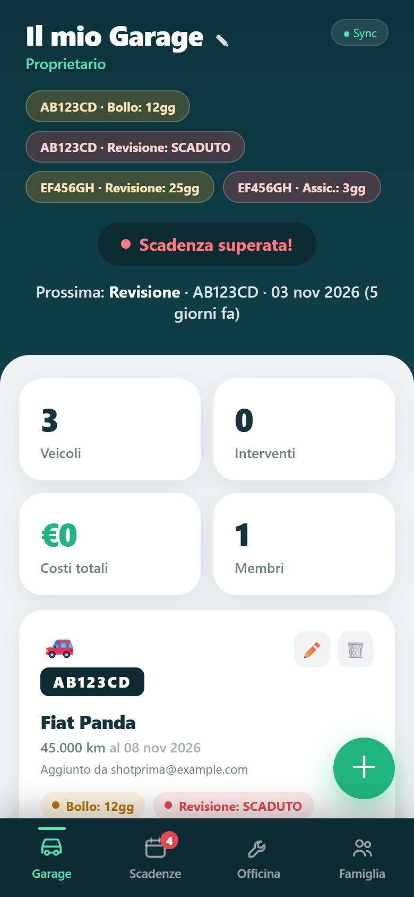 | 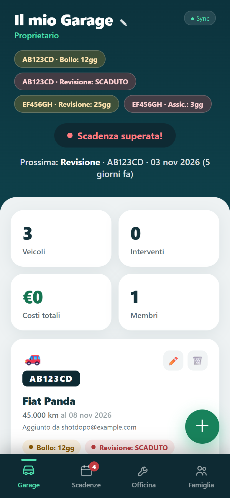 |
| Scadenze | 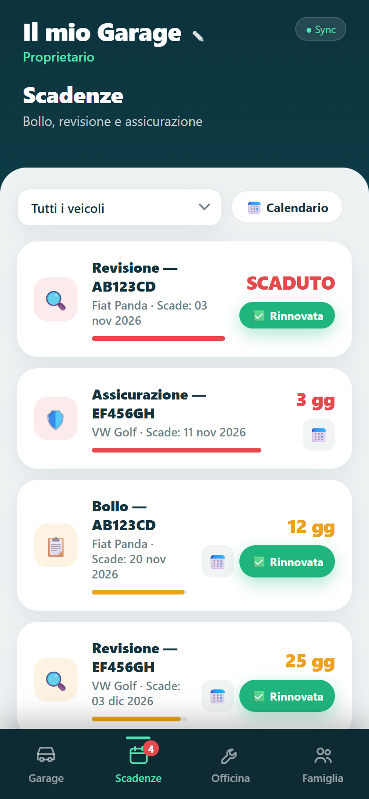 | 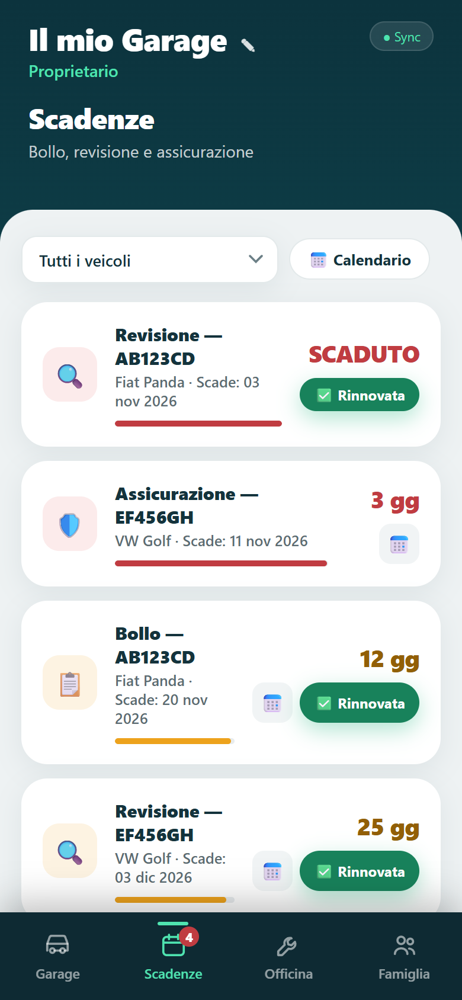 |

**Tema scuro: l'app non ne ha uno.** Gli screenshot con `prefers-color-scheme: dark` sono identici byte per byte a quelli chiari, per questo non li ho aggiunti. Un vero tema scuro è un'idea a parte (impegno S).

Scheda Spese (v2.6.0, prima dello spostamento in quinta posizione):

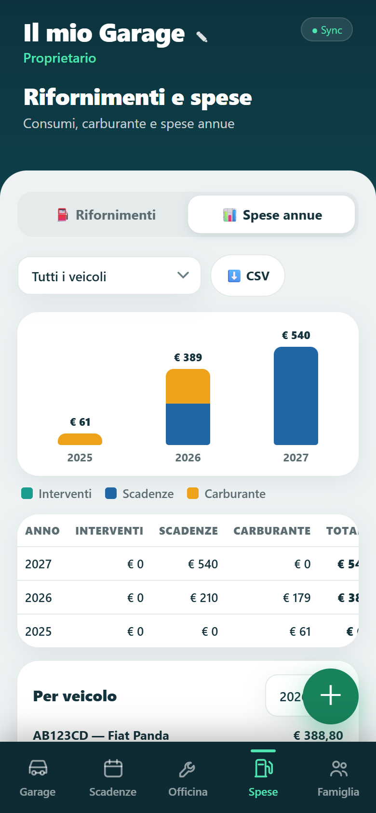 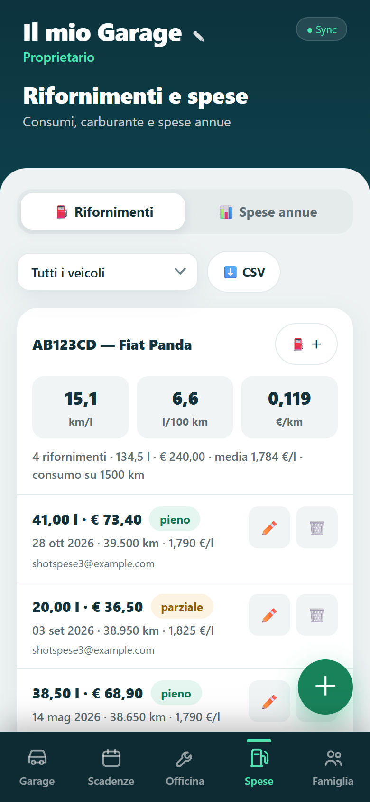

## 3. In corso e decisioni

### 3.1 «✅ Fatto» registra il pagamento — v2.6.1, IN PRODUZIONE
- Prima le regole: deploy autorizzato da te. Il ruleset `42869098` ha lo sha256 `df6b9cae…`, identico a `firestore.rules` della #14. Backup fatto alle 07:58.
- Poi il merge della **#14** (`e75baa7`, CI verde).
- Verifica: SW e cache 2.6.1, finestra `dd-amount` servita, 0 errori in console, pagina e rete, 0 violazioni CSP. La prova con login è da fare dal telefono.
- Funziona così:
  - la finestra mostra l'importo pagato, precompilato dal costo previsto e modificabile, e la data del pagamento (oggi); vuoto = nessun pagamento;
  - il pagamento va in `garages/{g}/payments` e conta in Spese (Scadenze) nell'anno del pagamento;
  - resta anche se la scadenza singola viene tolta e si cancella con il veicolo;
  - non c'è ancora un'interfaccia per correggerlo.
- Rollback delle regole: `firebase.rollback.json` → `pre-v2.6.rules` (senza `deadlines`, `refuels` e `payments`: va usato insieme al revert dell'app), oppure la versione precedente `e08c501a` in Console.

### 3.2 Date del vecchio bug — deciso: NON si esegue
- È il veicolo di un amico: lo avvisi tu e lui le corregge dall'app (✏️ → svuota bollo, revisione e assicurazione se non sono vere).
- Lo script `tools/admin/clear-bug-dates.mjs` resta nel repo, in dry-run di default. In produzione **non è mai stato eseguito con `--apply`**.

### 3.3 Promemoria: solo a te per 3 mattine (deciso) — cron verificato
- Resta tutto com'è: `REMINDERS_ALLOW_LIVE=yes`, `REMINDERS_ONLY_UID` = il tuo uid. Mattine 9, 10 e 11/11 alle 06:17 UTC; poi ti mostro i conteggi e decidiamo il passo 7.
- **Verifica di oggi (08:46 UTC):**
  - `reminders.yml` è su `main`, che è il branch di default. È entrato con il merge della #6 il 7/11 alle 18:47 UTC, quindi prima della prima occasione (8/11 06:17 UTC).
  - Il cron `'17 6 * * *'` è valido. `gh workflow list` mostra «Promemoria scadenze» **active** (id 410578849), e il lancio manuale funziona.
  - `gh run list --workflow "Promemoria scadenze" --limit 10` mostra solo i 2 lanci manuali (07:43 e 07:44 UTC). Nel repo ci sono **0 esecuzioni `schedule`** in assoluto.
- **Conclusione:** la configurazione è corretta. La prima esecuzione pianificata è stata **saltata da GitHub**, non ritardata (dopo 2 h 30 non c'era niente). Succede soprattutto con le prime pianificazioni di un workflow nuovo e negli orari di carico. Non ho cambiato niente.
- **Se salta anche domani (9/11):** aggiungo un secondo orario di riserva (es. `47 7 * * *`). Lo script è idempotente: il registro `pushLog` evita i doppioni e recupera le soglie saltate.

## 4. Problemi incontrati (onestamente)
- **Niente prova con login in produzione.** L'estensione Claude in Chrome non era connessa: nessun browser collegato, e ti ho mandato una notifica.
  - Al posto della prova, dopo ogni merge ho controllato con un browser headless anonimo: SW e cache della versione giusta, schermata di login, 0 errori in console, pagina e rete, 0 violazioni CSP.
  - I dati li ho letti dal backup admin: il tuo garage ha **5 veicoli**.
  - "Login + 5 veicoli" visti nell'app li deve confermare il tuo telefono (§5).
- **Il commit di #8 `4bf6940` mescola** il merge di F2 e le modifiche richieste: l'ha fatto l'agente, ed è dichiarato nel messaggio di commit.
- **Un 404 durante il redirect della v1** (una sola volta, non riprodotto): era una risorsa della pagina di redirect della v1, caricata prima del salto. Non riguarda la v2.
- Il cron dei promemoria di stamattina non risultava eseguito: GitHub a volte ritarda o salta i cron. Il recupero delle soglie copre i giorni saltati.

## 5. Cosa provare dal telefono
1. **Aggiornamento:** apri l'app → banner "Nuova versione" → una sola ricarica → menu: versione 2.6.0. Login, **5 veicoli**.
2. **Notifica di prova:** dovrebbe essere arrivata stamattina verso le 08:40, con 2 scadenze.
3. **Vecchia icona:** toccala → la v2 si apre con l'avviso, senza coprire il contenuto → «L'app è già installata…» → "Ho capito".
4. **Scadenze → +:** "Permesso ZTL", "Ogni anno", importo "80,50" → compare in lista. Poi "✅ Fatto" → la data avanza di un anno.
5. **⛽ dalla scheda veicolo:** pieno "38,5" l e "62,40" €, con km più alti di quelli attuali → i km del veicolo si aggiornano. Poi un parziale e un altro pieno → km/l ed €/km.
6. **Spese** (quinta voce): grafico per anno, totali, i due CSV.
7. **Nuovo veicolo** senza date → nessun "in scadenza oggi".

## 6. Rollback (se serve)
Procedura in `docs/DEPLOY.md`.
- Regole: `firebase.rollback.json` ora punta a `docs/rules-backup/pre-v2.6.rules`, il ruleset `ead41147` pubblicato fino a stamattina.
- App: `git revert -m 1 <merge>` su main, nell'ordine inverso: `bc31619`, `0414752`, `578691f`, `e13fa72`.
- Dati: backup `firestore-20261108-0734.json` e `restore-firestore.mjs`.

## 7. Come rilanciare i test
Invariato rispetto al 7/11, più `tests/unit/fuel.test.mjs`, `deadlines`, `f2-integration`, `tests/e2e/fuel.e2e.mjs` e `deadlines.e2e.mjs`, tutti in CI.
```sh
node --test tests/unit/*.test.mjs
cd tests/rules && npm test
cd tests/e2e && for t in csp calendar push legacy-banner pwa deadlines fuel; do node $t.e2e.mjs || break; done && node reminders.emu.mjs && node upgrade.e2e.mjs origin/main
```
